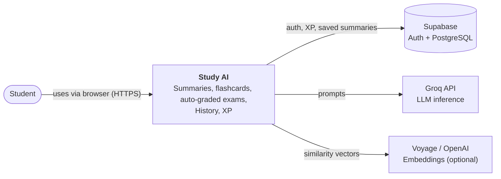
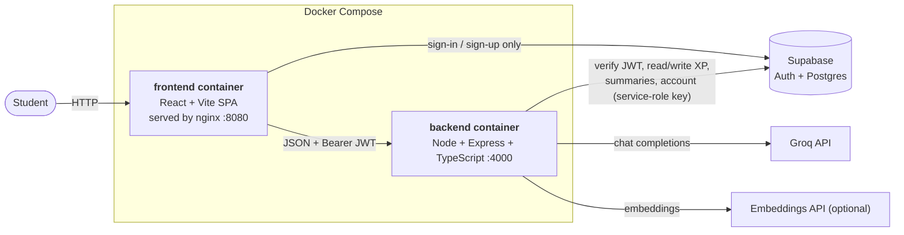
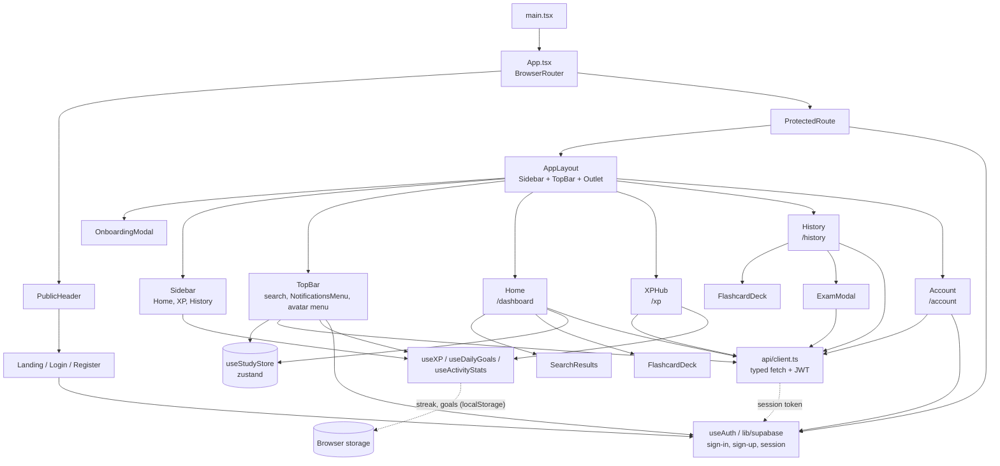
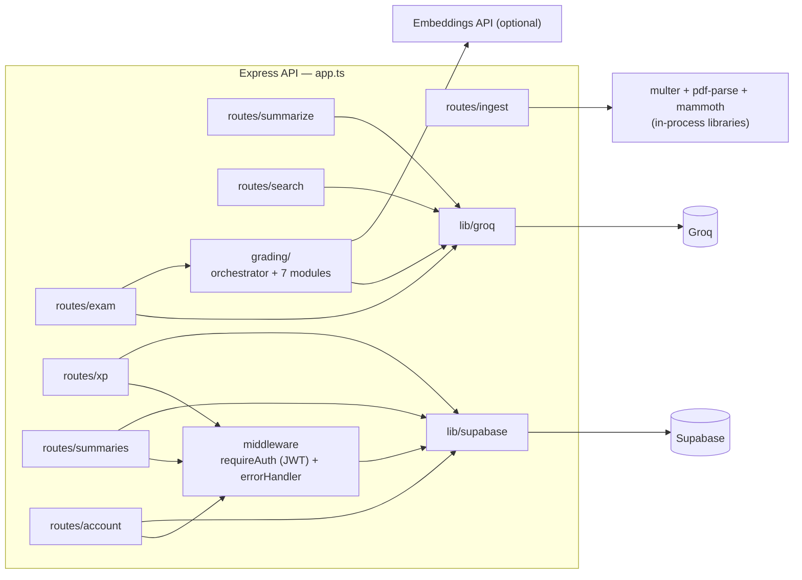
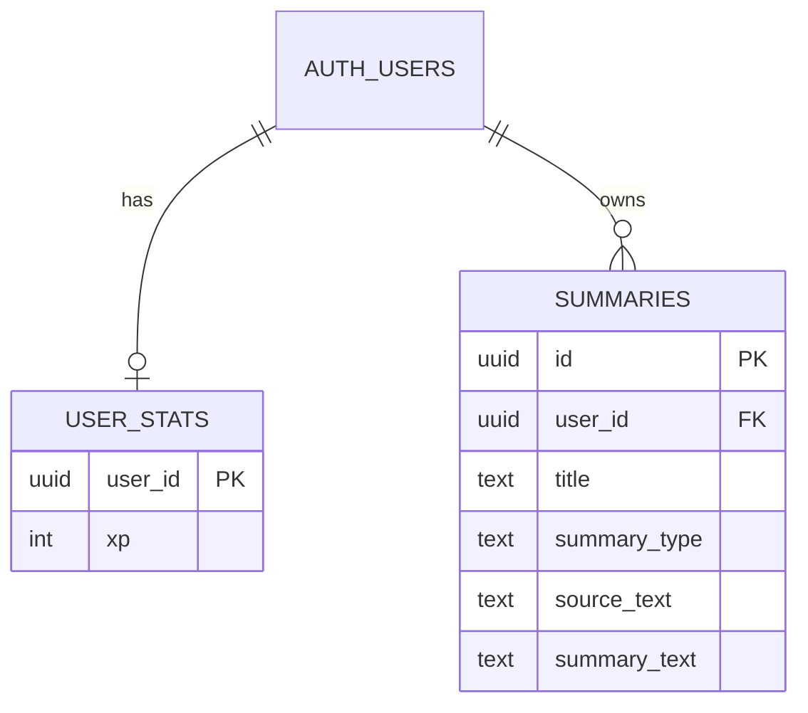
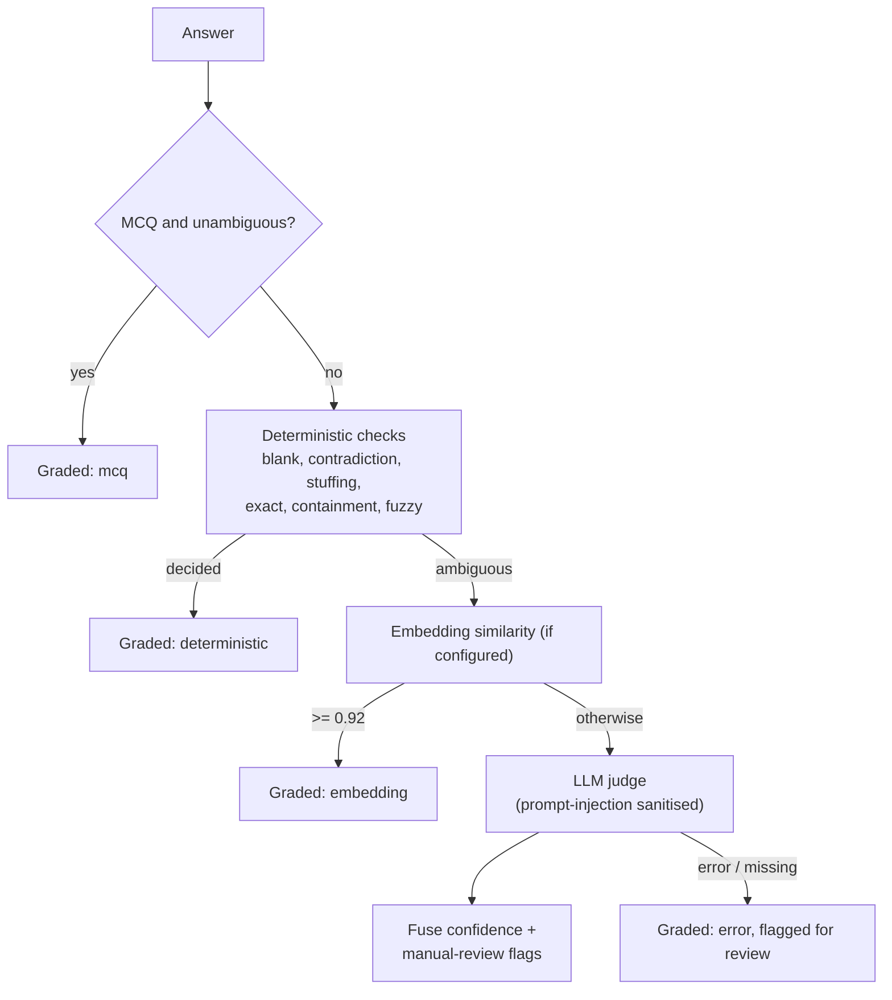
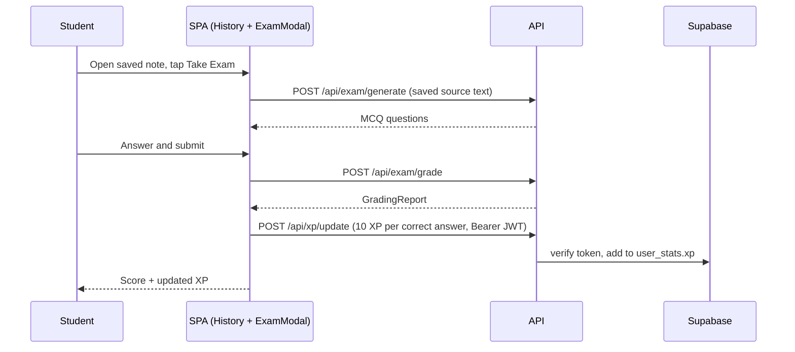

# Architecture

Notation: C4 model, drawn with plain Mermaid flowcharts so they render reliably on GitHub and in mermaid.live (Mermaid's dedicated C4 syntax is still experimental). Export PNG/SVG for your slides.

## Level 1 — System context

## Level 2 — Containers (what `docker compose up` starts)

## Level 3 — Frontend components (SPA)

## Level 3 — Backend components (API)

| Route | Auth | Purpose |
|-------|------|---------|
| `POST /api/ingest` | public | Extract text from PDF / DOCX / TXT |
| `POST /api/summarize` | public | Bullet, short, detailed summary or flashcards |
| `POST /api/search` | public | Answer a general question (Ask-AI bar) |
| `POST /api/exam/generate`, `/grade` | public | Create a 5/10-question MCQ exam; grade answers |
| `GET /api/xp`, `POST /api/xp/update` | JWT | Read / add XP |
| `GET/POST/DELETE /api/summaries` | JWT | History |
| `PATCH /api/account/username`, `/password`, `DELETE /api/account` | JWT | Account management |

## Data model (Supabase / PostgreSQL)

Both tables use `ON DELETE CASCADE` on the user and have Row Level Security enabled, so deleting an account removes every trace of the user's data.

## Grading pipeline (key algorithm)

## Sequence — take an exam from History and earn XP

## Key design decisions
- **Separate SPA and API** so secrets stay server-side and each part is independently testable and deployable
- **Auth in the browser, verification in the API**: Supabase issues tokens; the API validates them and never handles passwords
- **Cheap-first grading**: the LLM is a last resort, keeping cost, latency and hallucination risk down
- **Server-owned identity**: routes that touch user data take the user id from the verified JWT, never from the request body
- **Server truth for XP, browser convenience for streaks**: XP lives in `user_stats`; streaks and goal check-marks are `localStorage` indicators that may reset
- **Merged ingestion**: one `/api/ingest` replaces three duplicate extract routes
