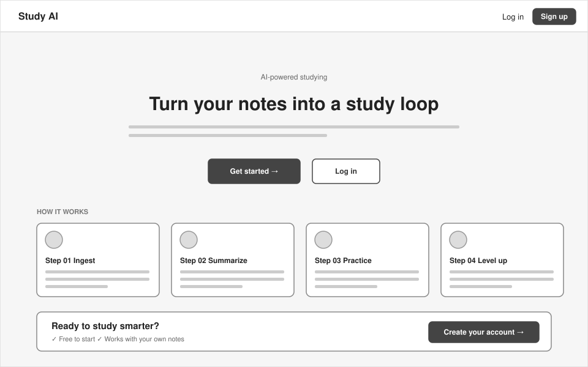
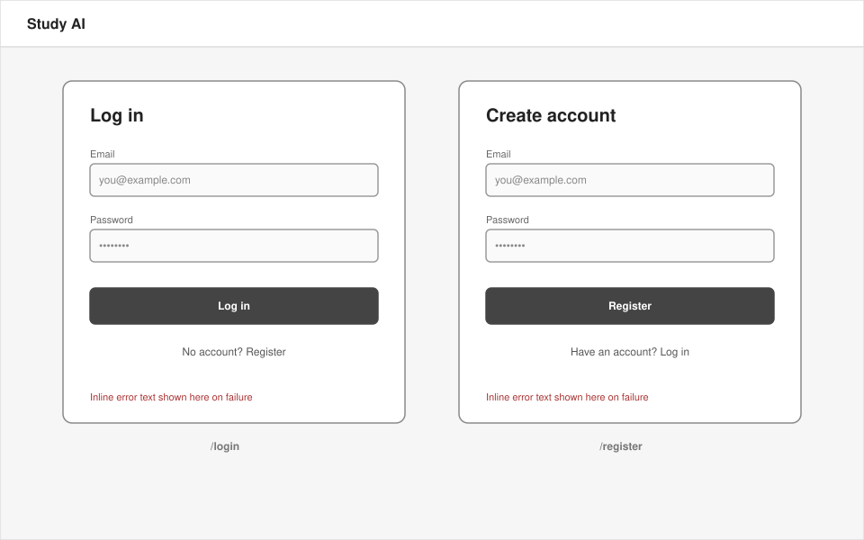
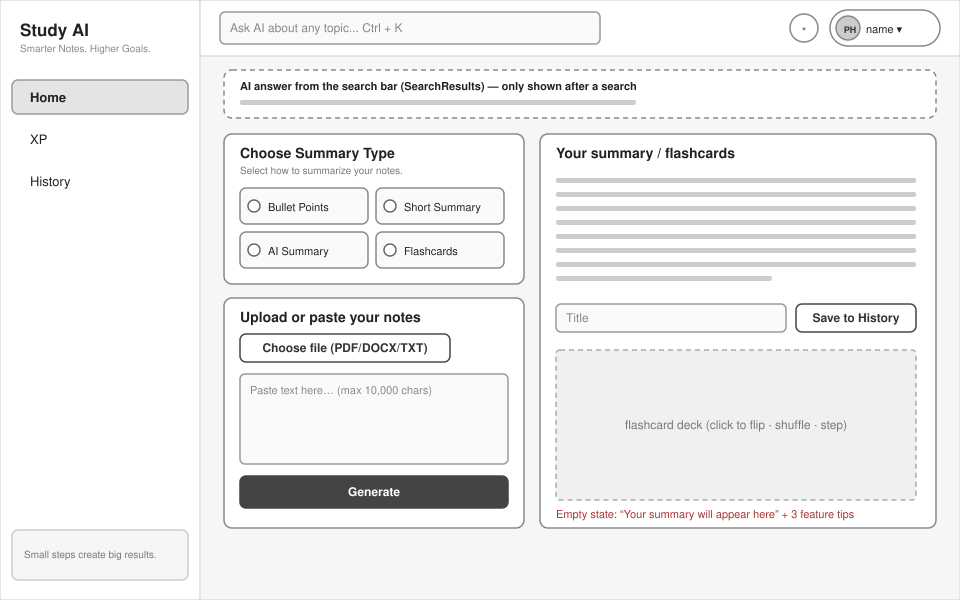
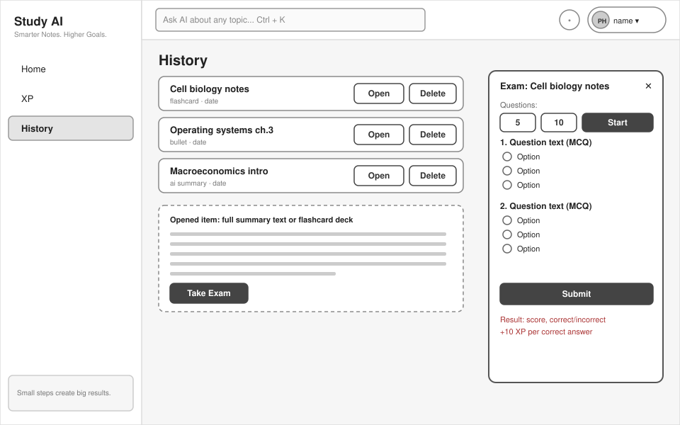
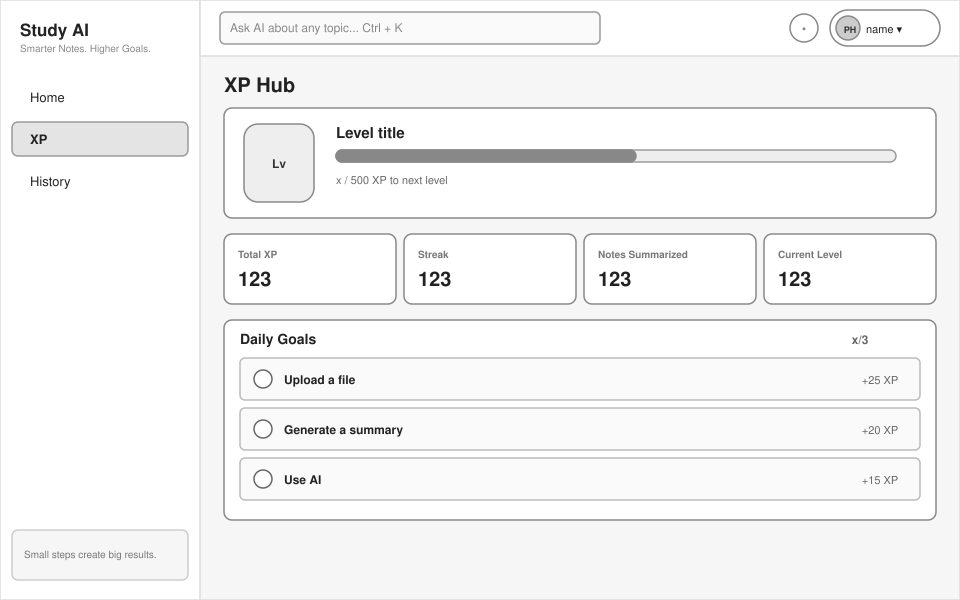
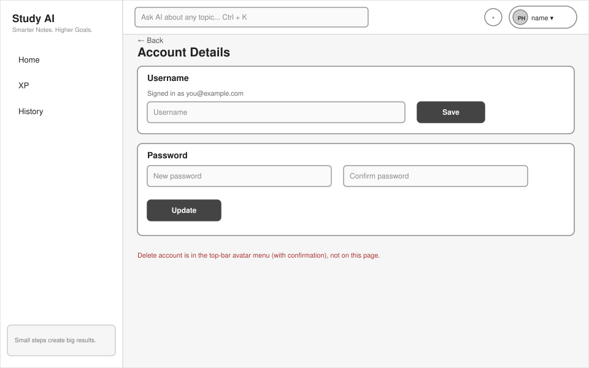

# Study AI — Written Concept

## 1. Problem
Students accumulate lecture notes, PDFs and slides but have no efficient way to (a) condense them into something reviewable and (b) test themselves on their own material. Existing tools solve one piece (flashcard apps, summarizers, quiz makers) but not the whole loop, and studying alone is hard to keep up without feedback or motivation.

## 2. Users
- University students preparing for exams (primary)
- Self-learners working through course material

## 3. Benefits
- **Saves time:** notes become a summary or a flashcard deck in seconds
- **Self-testing on your own material:** a 5- or 10-question multiple-choice exam generated from any saved note, graded instantly with per-question results
- **Motivation:** XP, levels, daily goals and a streak reward regular studying
- **A personal History** of summaries and flashcard sets that can be reopened or turned into an exam at any time

## 4. Why a web application (SPA)
- Notes live on laptops (PDF/DOCX files, long text), and large-screen reading and typing suit a browser
- No installation, and it works on any operating system
- A single-page application gives instant transitions between the stages of the study loop (add notes, summarize, save, test) without page reloads
- A backend is required: API keys (Groq, Supabase service role) must never reach the browser, and grading is business logic that should be testable server-side

## 5. Scope

### Functional requirements
| ID | Requirement |
|----|-------------|
| F1 | Register, log in and log out |
| F2 | Ingest notes by pasting text or uploading a PDF, DOCX or TXT file |
| F3 | Generate a summary (bullet points, short summary or detailed "AI" summary) or a flashcard deck, shown as a flip-card deck |
| F4 | Save summaries and flashcard sets to **History**; reopen and delete them |
| F5 | Take an AI-generated 5- or 10-question multiple-choice **exam from a saved note** |
| F6 | Auto-grade the exam; the grading engine returns a confidence score and manual-review flags |
| F7 | **XP, levels and daily goals** (XP Hub): XP for uploading, summarizing, asking the AI and answering exam questions correctly |
| F8 | **Ask-AI search bar** (Ctrl + K) for general questions |
| F9 | **Account page:** change username and password; delete the account |
| F10 | In-app **feature guide** (bell menu) and a first-visit onboarding walkthrough |

### Data storage
The XP total, saved summaries and user accounts are stored server-side in Supabase. Streaks, daily-goal check-marks and the "seen" flags for the onboarding and the feature guide are deliberately browser-local (`localStorage`): they are convenience indicators that do not justify additional tables.

### Out of scope
Leaderboard, focus timer, image OCR, spaced-repetition review scheduling, and short-answer exams in the interface. The exam API and grading engine already support short-answer questions, so adding them later needs only frontend work.

### Non-functional requirements
- **Security:** JWT verification on all routes that read or write user data (`xp`, `summaries`, `account`); the service-role key stays on the server; per-user data is protected by Row Level Security as a second line of defence; student answers are sanitised against prompt injection
- **Testability:** pure grading functions and mocked external services
- **Portability:** the whole system starts with `docker compose up`
- **Cost and latency:** cheap deterministic checks run before any LLM call

## 6. Components
| Component | Tech | Responsibility |
|-----------|------|----------------|
| SPA | React 18, Vite, TypeScript, react-router, zustand | UI, client-side routing, shared study state |
| API | Node 20, Express, TypeScript | Ingestion, AI orchestration, exam generation and grading, XP, saved summaries, account management |
| Auth + DB | Supabase (managed) | Users and sessions; tables `user_stats` (XP) and `summaries` (History) |
| LLM | Groq (default model `openai/gpt-oss-120b`, configurable via `GROQ_MODEL`) | Summaries, flashcards, exam generation, search answers, grading of ambiguous answers |
| Embeddings (optional) | Voyage | Extra similarity signal for grading |
| Browser storage | `localStorage` | Streak, daily-goal check-marks, "seen" flags |

The architecture is documented with C4 diagrams in [`architecture.md`](architecture.md).

## 7. Wireframes
All screens share one layout once signed in: a left sidebar (Home, XP, History) and a top bar (Ask-AI search, feature-guide bell, avatar menu with Account, Sign out and Delete account). The SVG files are in [`docs/wireframes/`](wireframes/).

| # | Screen | Route | Wireframe |
|---|--------|-------|-----------|
| 1 | Landing: headline, call-to-action buttons, 4-step "how it works" | `/` |  |
| 2 | Log in and Register cards | `/login`, `/register` |  |
| 3 | Home: summary type, upload or paste notes, summary or flashcard output, save to History, AI answer strip | `/dashboard` |  |
| 4 | History with an opened item and the Exam modal | `/history` |  |
| 5 | XP Hub: level, stats, daily goals | `/xp` |  |
| 6 | Account: username and password (Delete account is in the avatar menu) | `/account` |  |

## 8. Process model: Scrum (lightweight, solo)
**Justification**
- Requirements were discovered iteratively, so a plan-driven model such as Waterfall would have locked in the wrong scope
- Short sprints (1 week) give a working vertical slice each time (ingest → summarize → save → exam)
- The product backlog makes scope decisions explicit and defensible
- Solo adaptation: one person acts as Product Owner and Developer; sprint planning, a sprint review with the tutor and a retrospective are kept, and the daily stand-up is replaced by a short development log

**Sprints**
| Sprint | Goal |
|--------|------|
| 1 | Repository, CI, authentication, backend skeleton, ingestion |
| 2 | Summaries and exam generation |
| 3 | Grading engine and tests |
| 4 | Persistence (Supabase) and Docker Compose |
| 5 | Hardening and documentation |
| 6 | History (saved summaries), flashcard deck, exam from a saved note |
| 7 | XP Hub, daily goals, Ask-AI search bar |
| 8 | Account page, feature guide and onboarding, final documentation and evaluation |

The backlog was re-prioritised at the start of each sprint after reviewing the previous increment.

## Document history
| Version | Content |
|---------|---------|
| 1 | Concept submitted for approval: notes → summary → 10-question exam (5 multiple-choice + 5 short-answer) → SM-2 spaced-repetition review; XP, general AI search and notifications out of scope |
| 2 (this document) | Updated to describe the finished project: History, XP and daily goals, Ask-AI search, account page and feature guide added; the standalone practice exam and spaced-repetition review removed |
